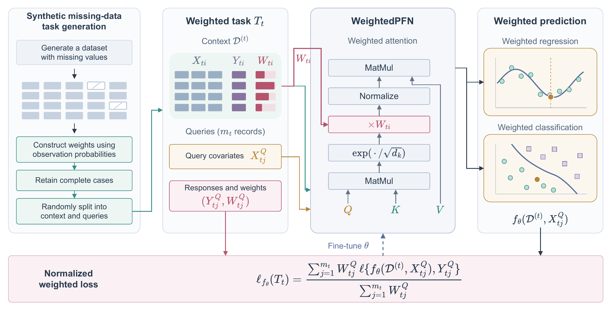

# WeightedPFN

**Tabular foundation models for weighted regression and weighted classification.**

Official code for the paper *Tabular Foundation Models for Weighted Regression and Classification*
(Junwen Xia, Yan He, Dehan Kong and Zhenhua Lin).

**Weighted regression** and **weighted classification** have applications ranging from missing-data analysis and
causal inference to insurance pricing and particle physics. Existing weighted methods must be fitted and tuned on each
dataset, which is costly for flexible nonlinear learners. Tabular foundation models such as TabPFN-3.5 avoid this cost
by predicting on a new dataset in a single forward pass, but they cannot use sample weights. We propose WeightedPFN,
which adapts TabPFN-3.5 to weighted prediction through weighted attention, a normalized weighted loss, and pretraining
on synthetic weighted prediction tasks from missing-data problems. It performs strongly on real missing-data and
out-of-distribution causal tasks while running about as fast as linear baselines.

This repository currently provides the fine-tuned weights and the inference code. The training code will be released
after the paper is published.

> **License.** WeightedPFN is built on TabPFN-3.5 and may be used only for non-commercial purposes under the
> TabPFN-3.5 Non-Commercial License. It is not an official Prior Labs product. See [License](#license).



## Installation

```bash
git clone https://github.com/xiajunwen1007/WeightedPFN.git
cd WeightedPFN
pip install -r requirements.txt   # requires tabpfn==9.2.0
pip install -e .
```

The two fine-tuned networks (one for weighted regression, one for weighted classification) are hosted on Hugging Face
at [xiajunwen/WeightedPFN](https://huggingface.co/xiajunwen/WeightedPFN). The repository is gated: accept the
TabPFN-3.5 Non-Commercial License on its page and log in with `hf auth login`. The weights are then downloaded
automatically when a model is first fitted and cached locally.

## Usage

```python
from weightedpfn import WeightedPFNClassifier, WeightedPFNRegressor

# Weighted regression
reg = WeightedPFNRegressor(device="auto")          # "auto", "cpu", "cuda", ...
reg.fit(X_train, y_train, sample_weight=w_train)
y_pred = reg.predict(X_test)

# Weighted classification
clf = WeightedPFNClassifier(device="auto")
clf.fit(X_train, y_train, sample_weight=w_train)
proba = clf.predict_proba(X_test)
```

`fit` only stores the weighted training rows; no parameters are updated. `X` may contain missing values (NaN).

`example.py` reproduces the missing-data setting of the paper: incomplete rows are dropped, and each complete case is
weighted by the inverse of its estimated observation probability.

```bash
python example.py
```

## License

WeightedPFN is a Derivative of the TABPFN-3.5 Model of Prior Labs GmbH: the weights were fine-tuned from TabPFN-3.5,
and the code in `weightedpfn/` modifies the TabPFN-3.5 architecture at run time. The weights and code in this repository
are therefore distributed under the **TABPFN-3.5 Non-Commercial License v1.0** (`LICENSE`). Any rights to use
them are granted to you directly by Prior Labs GmbH under that License; by downloading or using them you agree to its
terms. Please read the License before use. In particular:

- **Non-commercial use only.** The model may be used only for testing, evaluation or research not tied to commercial
  gain, production deployment or revenue generation. Its outputs (predictions, probabilities and other results) may also
  be used only for such non-commercial purposes. Commercial or production use requires a commercial license from Prior
  Labs (sales@priorlabs.ai).
- **No hosted service.** The model may not be offered as part of a hosted, managed, API or SaaS service, whether paid or
  free.
- **Redistribution.** Copies of the weights or code must include `LICENSE`, `LICENSE-Apache-2.0` and `NOTICE`, and
  may not suggest that they are an official Prior Labs product.
- **Other restrictions.** Section 4 of the License also excludes, among others, military, surveillance and biometric
  processing purposes.

**Third-party code.** `weightedpfn/_patch.py` adapts code from the `tabpfn` package (version 9.2.0, Copyright (c)
2026 Prior Labs GmbH), which is licensed under the Apache License 2.0; see `LICENSE-Apache-2.0` and `NOTICE`.

**Not an official product.** WeightedPFN is not an official product of Prior Labs GmbH and has not been endorsed,
approved or validated by Prior Labs GmbH.

**Attribution notice** (Section 3(b) of the License; also in `NOTICE`):

```text
The TABPFN-3.5 Model is licensed by Prior Labs GmbH under the TABPFN-3.5 Non-Commercial License.
Copyright © Prior Labs GmbH 2026.
THE SERVICES ARE PROVIDED FREE OF CHARGE: COMPANY SHALL NOT BE LIABLE FOR DAMAGES RESULTING FROM SLIGHT NEGLIGENCE.
LIABILITY FOR GROSS NEGLIGENCE AND INTENTIONAL MISCONDUCT REMAINS UNAFFECTED.

We have modified the TABPFN-3.5 Model: WeightedPFN was fine-tuned from the TabPFN-3.5 weights (checkpoint
tabpfn-v3.5-20260909), and its code changes the TabPFN-3.5 attention and column preprocessing so that training rows
can carry sample weights.
```

**Disclaimer.** WeightedPFN is provided "as is", without warranties of any kind, express or implied. To the extent
permitted by law, the authors and Prior Labs GmbH are not liable for any damages arising from its use; the limitation of
liability in Section 5 of the License applies.

## Citation

```bibtex
@misc{xia2026weightedpfn,
  title  = {Tabular Foundation Models for Weighted Regression and Classification},
  author = {Xia, Junwen and He, Yan and Kong, Dehan and Lin, Zhenhua},
  year   = {2026},
  note   = {Preprint}
}
```
